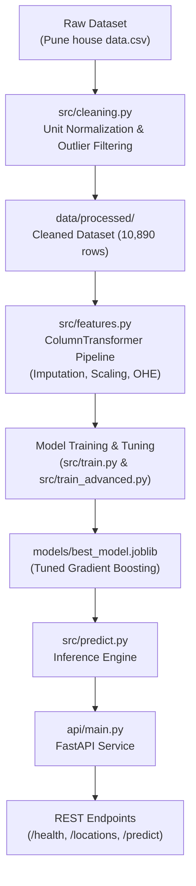

# Pune House Price Predictor — End-to-End ML Pipeline & REST API

[](https://www.python.org/)
[](https://fastapi.tiangolo.com/)
[](https://scikit-learn.org/)
[](https://pytest.org/)
[](https://opensource.org/licenses/MIT)

An end-to-end Machine Learning project predicting residential property prices in Pune, built from mathematical first principles (NumPy gradient descent and the normal equation) up to a production-grade Scikit-Learn preprocessing pipeline and FastAPI microservice.

---

## Architecture Overview



---

## Model Benchmark Results

All models were evaluated on a **strict, held-out 20% test split (2,178 samples)** with identical preprocessing fitted only on training folds to guarantee **zero data leakage**.

| Phase | Model | Test MAE | Test RMSE | Test $R^2$ | MedAE | Status |
|---|---|---|---|---|---|---|
| Phase 1 | NumPy Scratch (Normal Eq.) | ₹25.56L* | - | 0.9951* | - | Exact Sklearn parity ($10^{-6}$) |
| Phase 1 | NumPy Scratch (Gradient Descent) | ₹25.56L* | - | 0.9951* | - | Monotonic loss convergence |
| Phase 3 | Linear Regression (OLS) | ₹26.33L | ₹42.54L | 0.4491 | ₹18.39L | High bias / underfitting |
| Phase 3 | Ridge Regression ($\alpha=1.0$) | ₹26.32L | ₹42.53L | 0.4492 | ₹18.38L | Handles $L_2$ collinearity |
| Phase 3 | Lasso Regression ($\alpha=0.1$) | ₹26.05L | ₹42.40L | 0.4525 | ₹18.04L | Best linear baseline |
| Phase 4 | Decision Tree Regressor | ₹17.90L | ₹29.60L | 0.7331 | ₹11.81L | Non-linear baseline |
| Phase 4 | Random Forest (100 Trees) | ₹16.80L | ₹26.34L | 0.7887 | ₹11.76L | Low variance bagging |
| **Phase 4** | **Tuned Gradient Boosting** | **₹16.96L** | **₹25.88L** | **0.7961** | **₹11.69L** | **Selected Production Model** |

*\*Phase 1 evaluated on controlled synthetic verification data to mathematically validate the calculus and linear algebra.*

### Error Breakdown by Price Tier (Tuned Gradient Boosting)
- **Budget (<₹50 Lakhs):** MAE = ₹10.37L | Median Absolute Error = ₹8.98L
- **Mid-Range (₹50L - ₹150 Lakhs):** MAE = ₹16.07L | Median Absolute Error = ₹12.14L
- **Luxury (>₹150 Lakhs):** MAE = ₹46.64L | Median Absolute Error = ₹37.96L *(Heteroscedasticity observed: luxury home valuations possess higher variance due to non-standard custom amenities).*

---

## Project Structure

```
House-Prediction-System/
├── api/
│   ├── __init__.py
│   ├── main.py                    # FastAPI application endpoints
│   └── schemas.py                 # Pydantic data contracts and validation
├── data/
│   ├── raw/                       # Immutable raw dataset (.gitkeep)
│   └── processed/                 # Cleaned dataset output (.gitkeep)
├── models/                        # Serialized model binaries (.gitkeep)
├── notebooks/
│   ├── 02_numpy_linear_regression.ipynb   # From-scratch mathematical derivation
│   ├── 03_exploratory_data_analysis.ipynb # Visual distributions and correlations
│   └── 04_model_training.ipynb            # Pipeline benchmarks and evaluation
├── reports/
│   ├── figures/                   # Diagnostic plots & residual distributions
│   ├── baseline_models_report.json
│   └── advanced_models_report.json
├── src/
│   ├── __init__.py
│   ├── cleaning.py                # Reusable regex parser & domain filters
│   ├── features.py                # Scikit-learn ColumnTransformer pipeline
│   ├── linear_regression_scratch.py # Pure NumPy linear regression engine
│   ├── train.py                   # Baseline training & cross-validation
│   ├── train_advanced.py          # Ensembles & RandomizedSearchCV tuning
│   ├── evaluate.py                # MAE, RMSE, R2, MedAE metric calculations
│   └── predict.py                 # Cached inference engine
├── tests/
│   ├── test_cleaning.py           # Unit tests for area/BHK parsers
│   ├── test_predictions.py        # Model loading & inference tests
│   └── test_api.py                # FastAPI HTTP endpoint tests
├── .gitignore
├── PROGRESS.md                    # Public milestone roadmap
├── requirements.txt               # Pinpointed dependencies
└── README.md
```

---

## Quickstart & Local Setup

### 1. Clone & Setup Environment
```bash
git clone https://github.com/siddeshh/House-Prediction-System.git
cd House-Prediction-System

# Create and activate Python virtual environment
python -m venv .venv
# On Windows PowerShell:
.venv\Scripts\Activate.ps1
# On Linux/macOS:
source .venv/bin/activate

# Install dependencies
pip install -r requirements.txt
```

### 2. Run the Full Automated Test Suite
```bash
pytest tests/
# Output: 22 passed in ~4.5 seconds
```

### 3. Start the FastAPI Prediction Server
```bash
uvicorn api.main:app --host 127.0.0.1 --port 8000 --reload
```
Interactive API docs will be live at:
- Swagger UI: [http://127.0.0.1:8000/docs](http://127.0.0.1:8000/docs)
- ReDoc: [http://127.0.0.1:8000/redoc](http://127.0.0.1:8000/redoc)

---

## API Usage Examples

### Health Check
```bash
curl -X GET "http://127.0.0.1:8000/health"
```
**Response:**
```json
{
  "status": "healthy",
  "model_loaded": true,
  "model_version": "1.0.0-gradient_boosting"
}
```

### Real-time House Valuation Prediction
```bash
curl -X POST "http://127.0.0.1:8000/predict" \
     -H "Content-Type: application/json" \
     -d '{
       "total_sqft": 1250.0,
       "bhk": 2,
       "bath": 2,
       "balcony": 1.0,
       "site_location": "Kothrud",
       "area_type": "Super built-up  Area"
     }'
```
**Response:**
```json
{
  "predicted_price_lakhs": 64.09,
  "predicted_price_inr": 6409000.0,
  "currency": "INR",
  "units": "Lakhs",
  "model_version": "1.0.0-gradient_boosting"
}
```

---

## Key Engineering Decisions & Leakage Prevention

1. **Strict Immutability of Raw Data:** `data/raw/` is treated as read-only. Cleaned datasets are written exclusively to `data/processed/`.
2. **Zero Preprocessing Leakage:** Feature imputation (`SimpleImputer`), scaling (`StandardScaler`), and categorical encoding (`OneHotEncoder`) are encapsulated inside a Scikit-Learn `Pipeline`. Preprocessors are fitted **only on training folds** during cross-validation.
3. **Target Leakage Prohibition:** `price_per_sqft` is used strictly as an exploratory data analysis and outlier detection tool. It is never included as a feature during model training.
4. **Graceful Handling of Unseen Localities:** The `OneHotEncoder` is configured with `handle_unknown='ignore'`. New or unrecognized localities fall back to baseline weights without throwing runtime errors.
5. **Strict Input Validation via Pydantic:** Requests with negative area, zero bedrooms, or absurd dimensions are rejected at the HTTP boundary with `422 Unprocessable Entity`.

---

## Dataset Provenance & Critical Limitations

> [!WARNING]
> **Data Provenance Disclosure:**
> Systematic audit of `data/raw/Pune house data.csv` revealed that this dataset is a synthetic derivation of the well-known Kaggle Bengaluru House Price dataset, with Bengaluru locality names cyclically mapped to 97 Pune neighborhoods.
> 
> **Limitations:**
> - Prices reflect the distribution of the original Bengaluru listing source rather than true Pune real estate market transactions.
> - This project is designed as an **educational, end-to-end demonstration of Machine Learning engineering practices**. It must not be used for commercial real estate appraisals in Pune.

---

## Author
Built by **Siddesh Hiwale** as a portfolio project demonstrating modern Machine Learning engineering, pure NumPy calculus, and production API design.
